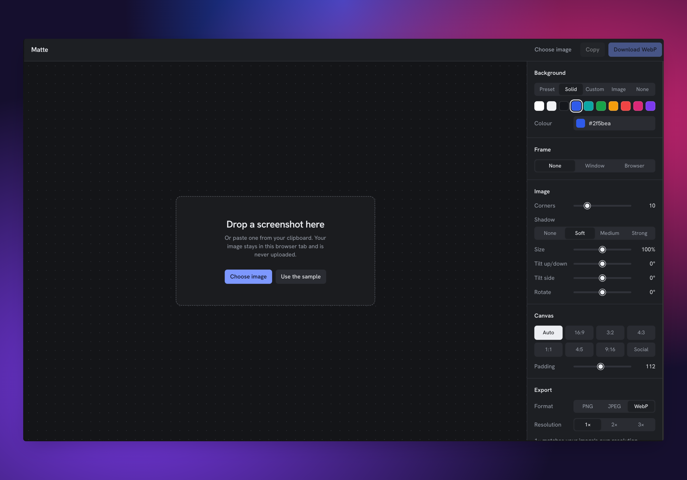
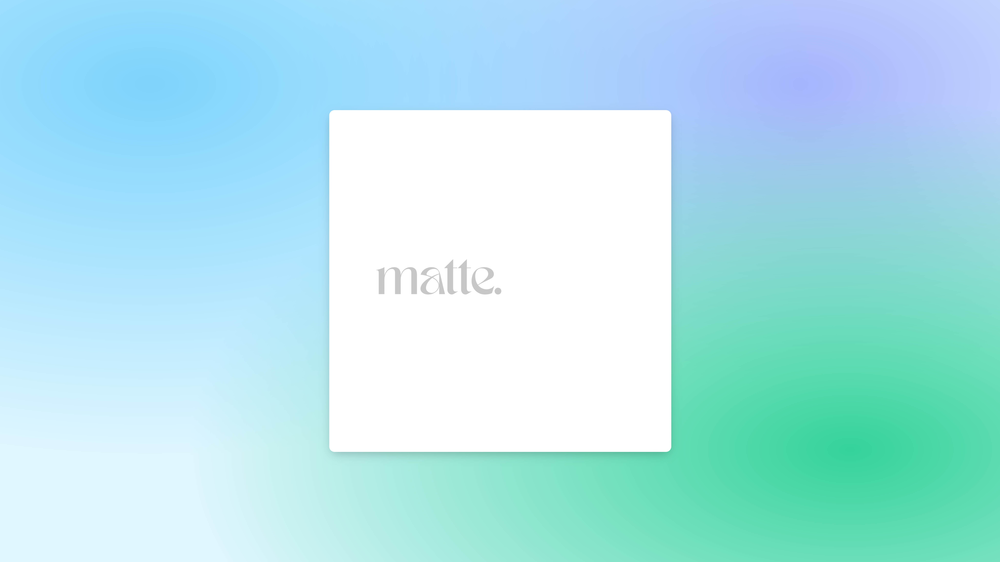

# Matte - Screenshot & Image Beautifier

Matte is a free screenshot & image beautifier: drop in an image, put it on a backdrop, wrap it in a window or browser frame, and export something ready to share. I built it because tools in this space tend to put the useful controls behind a subscription, and I wanted one where everything is simply available. Images never leave the browser; there’s no upload, no account, and no server doing the work.

It’s built with Next.js, TypeScript, and Tailwind, with Zustand holding editor state. Styling is proportional to the image, so the same padding, rounded corners, and window frame look right on a small crop or a 5K screenshot, and exports keep the image’s full resolution, with 2× and 3× options for sharper output.

---
### 

> Repurposed from an old project that I built when I discovered [carbon](https://carbon.now.sh/). I'll try to keep up with it this time. 🫡
